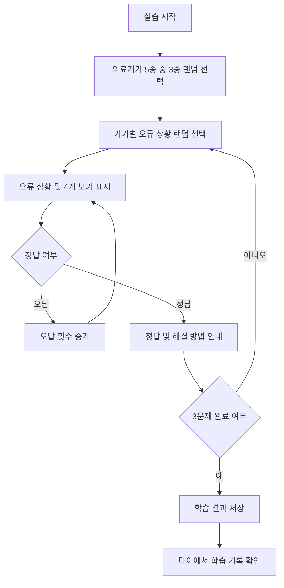
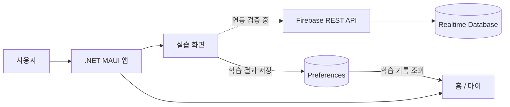

<p align="center">
  
</p>

<h1 align="center">Cortis</h1>

**의료기기 오류 대응 학습 앱 | Medical Device Error Training App**

의료기기에서 발생하는 오류 상황을 가상 실습으로 경험하고, 오류의 원인과 대응 방법을 학습할 수 있는 모바일 애플리케이션입니다.


## 1. 프로젝트 개요

| 항목 | 내용 |
| --- | --- |
| 프로젝트명 | Cortis |
| 개발 목적 | 의료기기 오류 상황에 대한 이해 및 대응 방법 학습 |
| 주요 대상 | 의료기기 관련 전공 학생 및 의료기기 사용법을 학습하는 초보자 |
| 개발 형태 | 전공 설계 프로젝트 / 모바일 애플리케이션 |
| 주요 플랫폼 | Android |

### 개발 배경

의료기기를 사용하는 과정에서는 센서 이탈, 연결 이상, 측정 오류 등 다양한 문제가 발생할 수 있습니다. 그러나 전공 학생들은 실제 기기를 반복적으로 조작하거나 여러 오류 상황을 직접 경험하기 어려울 수 있습니다.

Cortis는 이러한 상황을 앱에서 문제 형태로 제공하여, 실제 의료기기를 직접 조작하지 않고도 오류의 원인과 기본적인 대응 방법을 반복 학습할 수 있도록 기획하였습니다.

### 기대 효과

- 의료기기별 오류 유형 및 발생 원인에 대한 이해 향상
- 가상 실습을 통한 반복 학습 기회 제공
- 정답과 해설을 활용한 자기주도 학습
- 학습 기록을 기반으로 개인별 학습량 확인

## 2. 주요 기능

| 기능 | 설명 |
| --- | --- |
| 랜덤 실습 | 등록된 5종의 의료기기 중 서로 다른 3종을 무작위로 선택 |
| 오류 상황 출제 | 선택된 의료기기별 오류 상황을 무작위로 출제 |
| 4지선다 문제 | 오류 상황을 확인하고 4개의 보기 중 정답 선택 |
| 정답 및 오답 처리 | 오답 시 다시 선택하고 정답 시 오류 원인과 해결 방법 확인 |
| 실습 결과 기록 | 완료한 실습 횟수, 해결 문제 수, 오답 횟수 기록 |
| 학습 현황 | 하루 3문제를 목표로 학습 진행도를 표시하도록 구성 |
| 날짜별 학습 기록 | 마이 화면에서 학습 결과와 최근 날짜별 기록 확인 |
| Firebase 데이터 조회 | Realtime Database의 의료기기 및 오류 데이터를 조회하는 기능 개발 |

## 3. 학습 대상 의료기기

현재 준비한 학습용 데이터는 의료기기 5종, 오류 상황 12개로 구성되어 있습니다.

| 의료기기 | 오류 유형 | 상황 수 |
| --- | --- | ---: |
| 혈압계 | 커프 이상, 환자 움직임 | 2 |
| 심전도 모니터 | 전극 탈락, 환자 움직임 | 2 |
| 산소포화도계 | 센서 이탈, 저관류 | 2 |
| 수액펌프 | 수액 라인 폐색, 공기 유입, 주입속도 오류 | 3 |
| 인공호흡기 | 회로 분리, 회로 누출, 회로 폐색 | 3 |
| **합계** | | **12** |

※ 현재 데이터는 특정 제조사나 모델의 공식 알람 코드가 아닌 공통 학습용 시나리오입니다.

## 4. 실습 진행 방식



### 실습 문제 예시

**의료기기: 심전도 모니터**

심전도 측정 중 환자가 움직이면서 파형이 크게 흔들리고 심박수 표시가 불안정합니다. 어떤 오류일까요?

1. 전극 탈락
2. 환자 움직임
3. 센서 이탈
4. 회로 누출

<details>
<summary>정답 및 해설 보기</summary>

**정답: ② 환자 움직임**

환자의 움직임은 심전도 신호에 영향을 줄 수 있습니다. 본 예제는 측정값만으로 판단하지 않고 환자 상태 및 전극과 케이블의 상태를 확인해야 한다는 학습 내용을 전달하기 위한 시나리오입니다.

</details>

## 5. 주요 화면

아래는 개발 과정에서 Android 에뮬레이터로 실행한 실제 화면입니다.

| 홈 (Home) | 실습 (Practice) | 마이 (My) |
| :---: | :---: | :---: |
|  |  |  |

> 개발 중 캡처한 화면으로, 홈의 학습 현황 갱신과 의료기기 사진 영역은 개선 중입니다. 상단 아이콘은 선정한 디자인 시안이며 실제 앱 적용 여부는 확인되지 않았습니다.


| 화면 | 주요 구성 | 역할 |
| --- | --- | --- |
| 홈 (Home) | 오늘 날짜, 목표 진행도, 완료 실습, 문제 해결, 오답 횟수 | 오늘의 학습 목표 확인 및 실습 시작 |
| 실습 (Practice) | 기기 이름, 이미지 표시 영역, 오류 상황, 선택지, 해설 | 오류 상황을 판단하고 해결 방법 학습 |
| 마이 (My) | 학습 통계 및 날짜별 기록 | 실습 결과와 학습 이력 확인 |

홈과 마이는 하단 탭으로 이동할 수 있도록 구성하였으며, 실습 화면은 실습 시작 버튼을 통해 접근합니다.

## 6. 개발 환경

| 구분 | 사용 기술 |
| --- | --- |
| IDE | Visual Studio 2022 |
| Framework | .NET MAUI (.NET 9) |
| Programming Language | C# |
| UI | XAML, MAUI Shell |
| Database | Firebase Realtime Database |
| Local Storage | .NET MAUI Preferences |
| Communication | HTTP REST API, JSON |
| Test Environment | Android Emulator (API 35) |
| Version Control | Git, GitHub |

## 7. 시스템 및 데이터베이스 구조

### 시스템 구성



Firebase는 의료기기 및 오류 문제 데이터를 관리하기 위한 데이터베이스로 구성하였으며, 사용자 학습 기록은 현재 기기 내부의 Preferences를 사용합니다. Firebase 조회 기능과 랜덤 출제의 전체 연동은 추가 검증이 필요합니다.

### Firebase Realtime Database

```text
medicalDevices
├── bp
├── ecg
├── spo2
├── infusion_pump
└── ventilator
```

각 의료기기에는 기기 이름과 오류 목록이 포함되어 있습니다.

| 필드 | 설명 |
| --- | --- |
| `name` | 의료기기 이름 |
| `errors` | 해당 기기의 오류 목록 |
| `errorName` | 오류 이름 및 정답 |
| `situation` | 사용자에게 표시할 오류 상황 |
| `solution` | 학습용 대응 방법 및 해설 |

### 학습 기록 저장 방식

학습 결과는 날짜별 저장 키를 사용하여 로컬에 기록하는 구조입니다.

```text
Session_yyyy-MM-dd   : 완료한 실습 횟수
Solved_yyyy-MM-dd    : 해결한 문제 수
Wrong_yyyy-MM-dd     : 오답 선택 횟수
```

## 8. 프로젝트 구성

주요 파일의 역할을 기준으로 정리한 구조입니다.

```text
Cortis
├── App.xaml                    # 공통 앱 설정 및 리소스
├── AppShell.xaml               # 하단 탭 및 화면 이동
├── HomePage.xaml               # 홈 화면
├── HomePage.xaml.cs            # 홈 화면 동작 및 학습 현황 조회
├── PracticePage.xaml           # 실습 화면
├── PracticePage.xaml.cs        # 랜덤 출제, 정답 처리 및 기록 저장
├── MyPage.xaml                 # 마이 화면
├── MyPage.xaml.cs              # 날짜별 학습 기록 조회
├── FirebaseModels.cs           # Firebase 데이터 모델
├── FirebaseService.cs          # Firebase REST API 데이터 조회
├── MauiProgram.cs              # MAUI 앱 초기 설정
├── Resources/                  # 이미지, 앱 아이콘 및 스타일
└── Platforms/                  # 플랫폼별 설정
```

## 9. 실행 방법

1. GitHub 저장소를 Clone하거나 `Code > Download ZIP`으로 다운로드합니다.
2. Visual Studio에서 .NET MAUI 개발 워크로드가 설치되어 있는지 확인합니다.
3. 프로젝트의 솔루션 파일(`.sln`) 또는 프로젝트 파일(`.csproj`)을 엽니다.
4. 필요한 NuGet 패키지를 복원한 뒤 Android 에뮬레이터 또는 실제 Android 기기를 선택합니다.
5. Firebase 기능을 사용할 경우 자신의 Realtime Database를 준비하고 `FirebaseService.cs`에 데이터베이스 주소를 설정합니다. 학습용 JSON 데이터를 등록하고 적절한 읽기 권한을 구성합니다.
6. 프로젝트를 빌드하고 실행합니다.

> 공개 저장소에는 인증 토큰, 서비스 계정 키 등의 비밀 정보를 포함하지 않아야 하며, Firebase의 공개 쓰기 권한은 제한해야 합니다.

## 10. 개발 현황 및 향후 개선 사항

- [x] 홈, 실습, 마이 화면 구성
- [x] 의료기기 오류 랜덤 출제 및 정답·오답 처리
- [x] 로컬 학습 기록 저장 및 마이 화면 표시
- [x] Firebase 학습용 데이터 등록 및 조회 클래스 작성
- [ ] 홈 화면의 오늘 학습 현황 갱신 검증 및 개선
- [ ] Firebase 데이터 기반 랜덤 출제 전체 연동 검증
- [ ] 의료기기 이미지 및 앱 아이콘 적용 확인
- [ ] 제조사 및 모델별 오류 데이터 확장
- [ ] 사용자 인증 및 개인별 클라우드 학습 기록 관리

## 참고 자료

- [.NET MAUI 공식 문서](https://learn.microsoft.com/dotnet/maui/)
- [.NET MAUI Samples](https://github.com/dotnet/maui-samples)
- [Firebase Realtime Database](https://firebase.google.com/docs/database)
- [Firebase REST API](https://firebase.google.com/docs/database/rest/start)

---

본 프로젝트는 의료기기 오류 대응을 학습하기 위한 교육용 프로젝트입니다. 실제 임상 판단이나 의료기기 조작을 위한 지침으로 사용하지 않으며, 실제 대응은 해당 제조사의 공식 사용설명서와 의료기관의 절차를 따릅니다.
